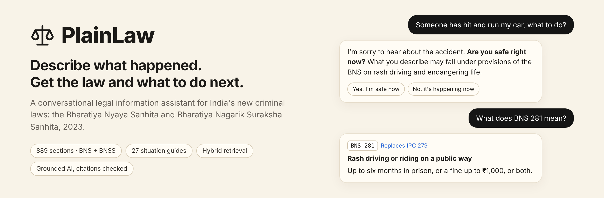
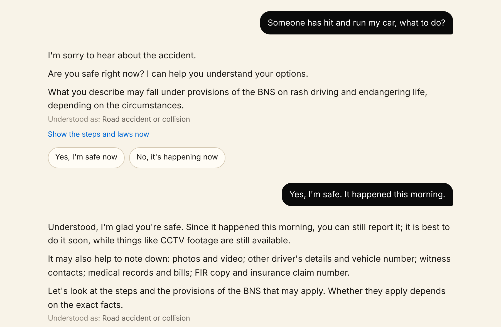
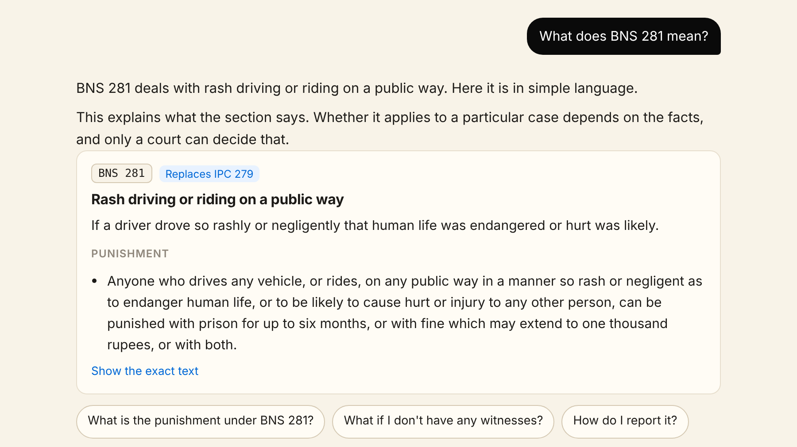
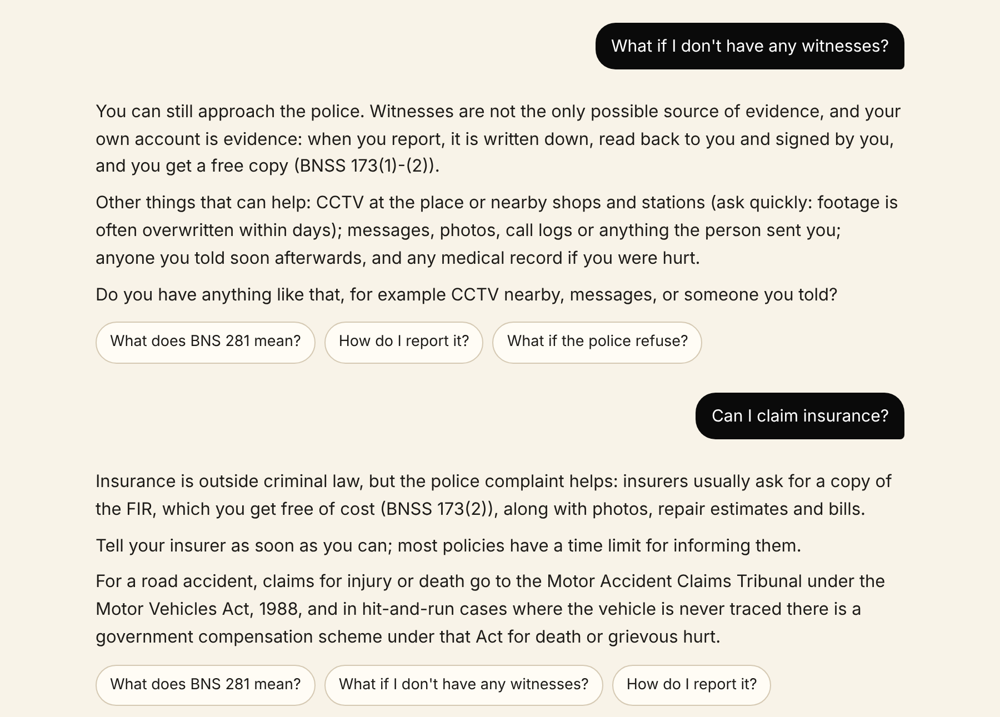
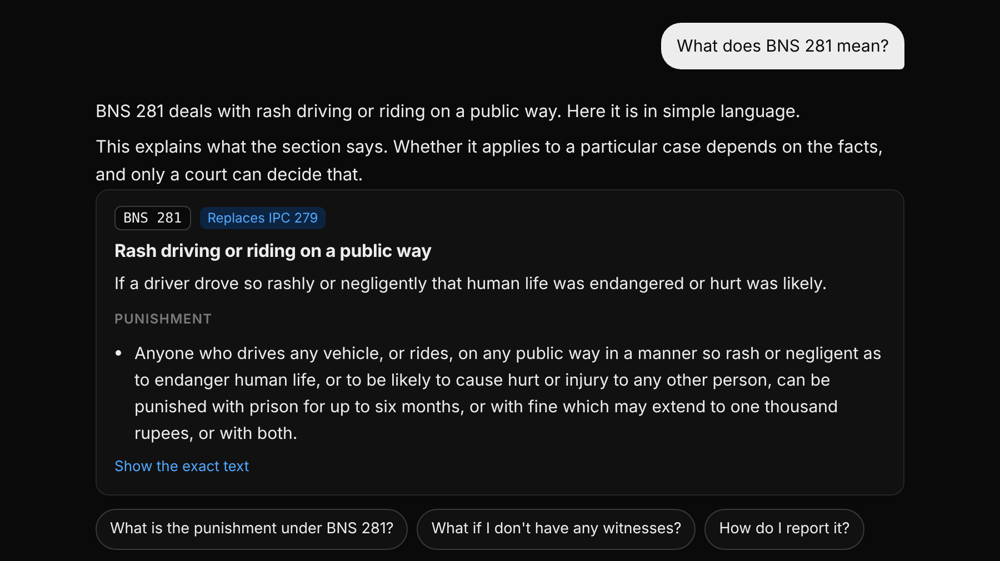
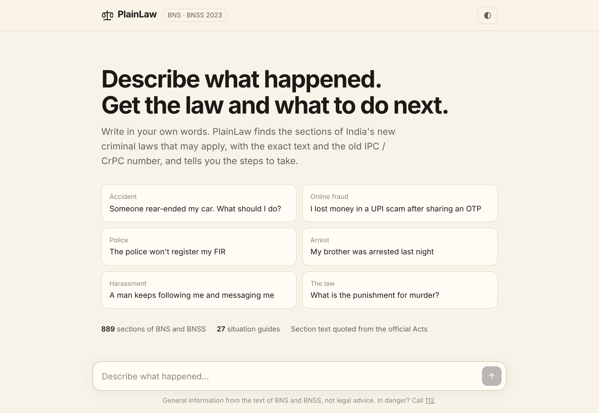
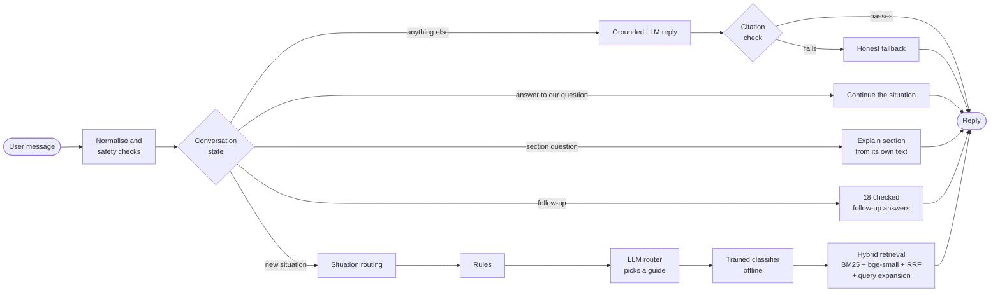

<p align="center">
  
</p>

<p align="center">
  
  
  
  
  
  
</p>

<p align="center">
  <b>Built by Siddarth Valasubramanian</b> · B.Tech CSE (Data Science), UPES Dehradun<br>
  🌐 <b>Live demo:</b> public link on Vercel coming soon
</p>

---

On **1 July 2024** India replaced the Indian Penal Code and the Code of Criminal Procedure with the **Bharatiya Nyaya
Sanhita (BNS)** and the **Bharatiya Nagarik Suraksha Sanhita (BNSS)**. Every section number changed ("Section 420" is now
**BNS 318**), people describe their problems in everyday words, and general AI chatbots still quote the old, repealed
numbers.

**PlainLaw** is a chat assistant that understands a situation in plain English, tells you which sections of the new laws
*may* apply, explains them in simple words, and walks you through what to do next. Every section it shows is quoted from
the official Acts, and every section an AI writes into a reply is checked against them before you see it.

## 💬 See it in action

> **You:** Someone has hit and run my car, what to do?

<p align="center"></p>

It starts with empathy and a safety check, says which area of law may be involved, and keeps the full plan one click
away. Once you're safe, you get the steps, what to note down, and the provisions that may apply.

> **You:** What does BNS 281 mean?

<p align="center"></p>

It knows which section you mean from the conversation and explains it from the section's own text: what it covers, the
punishment in plain words, and the old IPC number it replaced.

> **You:** What if I don't have any witnesses? · Can I claim insurance?

<p align="center"></p>

Follow-up questions are answered in the context of *your* situation, with the sections they rely on (BNSS 173, the
Motor Vehicles Act route for hit-and-run compensation, and so on).

<details>
<summary><b>🌙 Dark mode and the home screen</b></summary>
<br>
<p align="center"></p>
<p align="center"></p>
</details>

## ✨ What it can do

| | Feature | Example |
|---|---|---|
| 🧭 | **Understands situations** in everyday English and maps them to one of 27 verified guides | "a guy on a bike snatched my chain" → theft and snatching guide |
| 🛟 | **Safety first**: self-harm, emergencies and fires are recognised at any point in the chat | "my car is on fire" → move away, call 101 / 112 |
| 🗣️ | **Remembers the conversation**: answers to its own questions, "section 75", "the first one", "it" | "explain the first one" → BNS 303 in plain words |
| ❓ | **18 kinds of follow-up**: no witnesses, report online, which station, police refusal, delay, lawyer, insurance, arrest, compensation, workplace (POSH Act)… | "what if the police refuse?" → BNSS 173(4), 175(3) |
| 🤖 | **Grounded AI replies** for anything else, with every cited section verified against the official text | "shall I take my belongings out?" → a short, checked answer |
| ⚖️ | **Knows its limits**: civil matters, other Acts, and events before 1 July 2024 | rent deposit → civil court; "in 2022" → old IPC may apply |
| 🔢 | **Old number lookup** | "IPC 420" → BNS 318 (Cheating) |

## 🧠 How it works



| Stage | NLP technique |
|---|---|
| Building the corpus | PDF extraction, regex segmentation, validation against the Acts' tables of contents (889 sections) |
| Understanding the message | normalisation, tokenisation, Porter stemming, intent detection, language and safety detection |
| Bridging everyday and legal words | query expansion with a plain-language glossary and legal-name synonyms |
| Finding the law | BM25 + dense embeddings (bge-small-en-v1.5) fused with Reciprocal Rank Fusion, with an abstention gate |
| Picking the situation | rules, LLM zero-shot classification (constrained to 27 ids), logistic regression on embeddings |
| Conversation | dialogue state, coreference ("it", "the first one"), follow-up intent detection |
| Answering open questions | retrieval-grounded generation with citation verification |

## 🚀 How to run it

You need **Python 3.10+** ([python.org](https://www.python.org/downloads/)). The first start installs everything into a
private `.venv` folder and downloads the embedding model (a few minutes, one time only).

| System | Do this |
|---|---|
| 🍎 macOS | Double-click **`start.command`** (or run `./start.command` in Terminal) |
| 🪟 Windows | Double-click **`start.bat`** |
| 🐧 Any system | See the commands below |

```bash
python3 -m venv .venv
.venv/bin/pip install -r requirements-run.txt          # Windows: .venv\Scripts\pip install -r requirements-run.txt
.venv/bin/python -m uvicorn api:app --port 8000        # Windows: .venv\Scripts\python -m uvicorn api:app --port 8000
```

Then open **http://localhost:8000**.

> **Optional AI features.** Create a free key at [console.groq.com](https://console.groq.com) and save it as one line in
> a file called `groq_key.txt` in the project folder. It is in `.gitignore`, so it is never uploaded. With the key, an
> AI model (gpt-oss-120b, falling back to gpt-oss-20b on rate limits) helps understand unusual messages and answers
> open follow-up questions. Without it, PlainLaw runs fully offline on rules, search and its trained classifier.

## 📊 Results

Measured on a **frozen held-out test** of 150 questions written after the system was fixed, and run once. The questions
are synthetic (not real users) and the labels were not checked by a lawyer; see [EVALUATION.md](EVALUATION.md) for the full
method, confidence intervals and limitations.

| What | Result |
|---|---|
| Full system (offline): right guide, or the right non-answer | **79%** (95% CI 72–85%) · wrong 10% · asked a clarifying question 11% |
| Trained classifier vs rules alone | **+12 points** (67% → 79%) |
| A relevant section among those shown | **79%** |
| Retrieval alone (hybrid + expansion): relevant section first / in top 3 | 35% / 55% |
| Conversation handling (12 scripted conversations, 42 turns) | 38/42 first run → 40/42 |
| Safety cases (emergencies, self-harm, scams, civil matters, word traps) | 49/51 |
| Live AI chat test (17 open questions) | 15 answered, **0 blocked** by the citation check |
| Speed (CPU) | median 1 ms per message, p95 90 ms |

In a comparison on 48 questions, general AI models **without access to the law text** cited repealed IPC/CrPC sections in
over 90% of their citations when asked naturally. That is the reason PlainLaw grounds every citation in the official Acts.

## 🗂️ Project structure

```
PlainLaw/
├── api.py                  FastAPI backend: /api/chat, /api/health, serves the web UI
├── web/index.html          the chat interface (no framework, light and dark themes)
├── src/
│   ├── dialogue.py         conversation manager: state, safety check-in, follow-ups, explanations
│   ├── chatbot.py          situation routing, retrieval answers, lookups, scope checks
│   ├── retrieval.py        BM25, dense embeddings, RRF fusion, abstention gate
│   ├── glossary.py         plain-language → legal vocabulary, civil and other-Act rules
│   ├── playbooks.py        27 situation guides, embedding suggestions, trained classifier
│   ├── llm_router.py       LLM that picks a guide (choice only)
│   ├── llm_chat.py         grounded LLM replies + citation check
│   ├── safety.py · dates.py · intent.py
├── data/
│   ├── sections.jsonl      889 sections of BNS + BNSS with old IPC/CrPC numbers
│   ├── playbooks.json      the 27 situation guides
│   └── eval_*.jsonl        evaluation sets (see data/README.md)
├── tests/                  8 test suites
├── eval_*.py · train_router.py · data_audit.py
├── deploy/                 Vercel (static UI) and Docker (API) setups
└── EVALUATION.md           audit, full results, error analysis, limitations
```

## 🧪 Tests and evaluation

```bash
python3 tests/test_playbooks.py        # every cited section exists; 38 routing cases
python3 tests/test_dialogue.py         # the conversation keeps context; follow-up citations exist
python3 tests/test_safety.py           # self-harm (any person), scams, story/game/code word traps
python3 tests/test_llm_chat.py         # the citation check rejects invented sections, old numbers, fake phone numbers
python3 tests/test_dates.py            # the pre-July-2024 notice
python3 eval_final.py [--llm]          # frozen 150-question test: baselines A-D, abstention, full system, latency
python3 eval_dialogue.py               # 12 multi-turn conversations
python3 eval_safety.py                 # 51 safety cases
python3 train_router.py                # trains and compares the situation classifier
python3 data_audit.py                  # corpus integrity and provenance (data/VERSION.json)
```

<details>
<summary><b>More technical detail</b></summary>

- **Data:** section text comes only from the official Act PDFs in `data/source/` (BNS as on 6 Oct 2025 from India Code;
  BNSS as enacted). Old numbers come from the CAPT Bhopal comparison tables. 54 new sections replace several old ones and
  5 old sections split into two; all are shown.
- **Embedding model:** loads from `models/bge-small-en-v1.5` if present, otherwise downloads from Hugging Face on first
  start (129 MB, not in this repository). Section embeddings are cached in `.cache/`. `DENSE_MODEL=lsa` forces an offline
  TF-IDF + LSA fallback.
- **Environment variables:** `LLM_BASE` / `LLM_KEY` (set automatically from `groq_key.txt` by the start scripts),
  `LLM_CHAT_MODELS` (default `openai/gpt-oss-120b,openai/gpt-oss-20b`), `LLM_ROUTER=off` to disable the AI,
  `LOCAL_LLM_MODEL` for a local Ollama model.
- **Deployment:** `deploy/vercel/` hosts the web UI as a static site pointed at the API via `config.js`;
  `deploy/space/` is a Docker image of the API.
- **Development-set results**, the LLM comparison and the contamination ledger are in [EVALUATION.md](EVALUATION.md).

</details>

## ⚠️ Limitations

- English only. 27 situation guides; anything else falls back to retrieval and the AI.
- Evaluation questions are synthetic and single-author; labels and guidance have not been reviewed by a lawyer.
- A valid section number does not mean the section applies: PlainLaw cannot check facts such as intention, consent or
  the value involved, so it says sections *may* apply and asks when unsure.
- BNS 106(2) (hit-and-run causing death) is shown as not yet in force (it had not been notified as of mid-2026).
- With the optional AI on, your message is sent to an external API (the interface says so).

---

<p align="center">
  <b>PlainLaw gives general legal information, not legal advice.</b><br>
  In an emergency, call <b>112</b> · Free legal aid: <b>NALSA 15100</b> · Women's helpline: <b>181</b>
</p>
